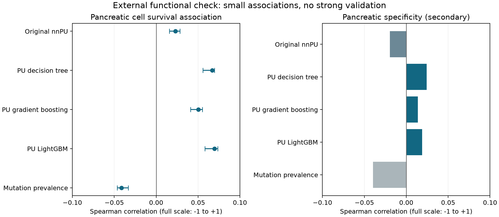

# External functional assessment — 4 November 2026

## What we learned

The shortlisted models have **weak associations** with pancreatic cancer cell survival effects.
The tree models have larger point estimates than the original nnPU, but this does not establish
a winning driver-gene model. None of the four models' top-100 lists is enriched against random
gene sets. Pancreatic specificity is close to zero. Keep this as a limited, mixed result.

In everyday terms: we ranked genes, then checked a separate experiment in which researchers
switched genes off in cancer cells. A useful survival-related ranking should put genes near the
top whose removal hurts those cells. Our rankings show a small overall relationship, but their
very top candidates do not convincingly pass that check.



## What was fixed before evaluation

The four models and mutation-prevalence control were copied from existing predictions, with
checksums saved before downloading functional measurements. No model was fitted, tuned or
selected using these outcomes. The shortlist itself was informed by the already-consumed local
test split; this is not a wholly prospectively designed project.

- Original specification: `configs/external_validation_v1.json`.
- Schema resolution before comparisons: `configs/external_validation_v1_schema.json`.
- Exact frozen scores: `data/processed/external_validation_v1/frozen_predictions.npz`.
- Source provenance: `data/raw/validation/project_score_2025/source_manifest.json`.

The initial Broad DepMap 24Q4 requests returned HTTP 403. We used the official Sanger public
Project Score archive instead: Sanger v2/Broad 21Q2, release dated 24 June 2025. Model metadata
is dated 13 October 2026. This is not the initially proposed DepMap 24Q4 Chronos release.

## Cohort and safeguards

| Item | Included or rule |
|---|---|
| Pancreatic cohort | 33 distinct donors, annotated pancreatic adenocarcinoma or ductal adenocarcinoma |
| Other cancer comparator | 856 distinct donors; all pancreas, unknown tissue and donor overlaps excluded |
| Gene matching | 17,601 unique unversioned Ensembl matches |
| Primary analysis | 15,767 previously unlabelled genes with available essentiality annotations |
| Training overlap | PANC-1 and its donor-related KP-1N excluded; HPNE exclusion rule also applied |
| Repeated cell models | Prefer Sanger over Broad for duplicate models; median across models sharing a donor |
| QC and coverage | Source QC pass; at least 80% pancreatic donor coverage; specificity also requires 80% comparator coverage |
| General survival genes | Source common-essential or pan-cancer core-fitness annotations excluded from primary analysis |
| Known driver positives | Excluded from primary analysis, retained separately as descriptive controls |

The measurement is corrected CRISPR fold change. More negative means stronger depletion.
The primary test correlates model rank with **negative median pancreatic fold change**. It does
not turn unlabelled genes into proven negatives or claim to calculate clinical accuracy/AUROC.

## Results

| Model | Primary correlation | 95% donor-bootstrap interval | Pancreatic specificity correlation |
|---|---:|---:|---:|
| Original nnPU | 0.0229 | 0.0157 to 0.0284 | -0.0194 |
| PU decision tree | 0.0670 | 0.0557 to 0.0697 | 0.0245 |
| PU gradient boosting | 0.0504 | 0.0409 to 0.0550 | 0.0138 |
| PU LightGBM | 0.0695 | 0.0582 to 0.0735 | 0.0188 |
| Mutation prevalence | -0.0415 | -0.0466 to -0.0333 | -0.0398 |

Correlation ranges from -1 to +1; these effects are small. The four primary one-sided permutation
tests all have Holm-adjusted p approximately 0.002, using 2,000 permutations (minimum raw p
1/2,001). Small p-values here are not evidence of a large or clinically useful effect. Permuting
genes assumes exchangeability and does not adjust for expression, gene length, network structure
or other biological confounding. The 200 donor-bootstrap intervals describe stability across
these cell models, not uncertainty in performance on patients. No pairwise model superiority
test was registered; a slightly larger point estimate is not a justified winner declaration.

The specificity endpoint compares other-cancer median fold change minus pancreatic median
fold change. It uses a pooled, heterogeneous other-cancer comparator, not healthy pancreas.
Its near-zero results offer little evidence of pancreatic specificity.

### Do the top predictions work better than random gene sets?

None of the four top-100 lists has a one-sided enrichment p below 0.05. Their median fold changes
are 0.1108–0.1309 (nnPU 0.1165), versus random-set medians near 0.100–0.101. A higher value is
not stronger depletion. These lists do not show the intended enrichment.

Only the decision-tree nominal top-500 result is enriched in this secondary check. However,
ties expand that group to **1,684 genes**, with median fold change 0.0853 and unadjusted
p approximately 0.0005. It is not a compact 500-gene list. The random comparison uses the
same actual group size. All secondary enrichment p-values are exploratory and unadjusted.
Full counts and results are in `top_gene_enrichment.csv`.

Including broadly essential genes raises correlations (tree approximately 0.122; LightGBM
approximately 0.132). That sensitivity result reinforces why the primary analysis excludes
general survival genes: generic cell viability can look like useful cancer ranking.

## What this does and does not mean

Switching off a gene in an established cancer cell tests a survival dependency. It does not test
whether a mutation originally caused the cancer. In particular, a tumour-suppressor gene may
already have lost its function; knocking it out again need not kill the cell. This distinction
means the weak result neither validates the driver predictions nor proves that every driver
prediction is wrong. Candidate evidence files are research leads, not validated biomarkers.

This is an external measurement source, not a proof of complete biological independence:
the models share gene-level biology, source essentiality calls use screening data, and the
feature-generation tissue and cell-model evidence can correlate with viability. Source and
culture effects may remain in the combined fold-change values. Donor exclusions reduce known
sample overlap but cannot certify unknown historical relationships.

## Decision and next work

1. Retain nnPU and the tree models as exploratory comparators. Do not replace the baseline
   solely because LightGBM has the largest external point estimate.
2. Audit top candidates for generic essentiality, expression and mutation-frequency confounding.
3. Before new testing, lock a driver-specific external evidence set and its exclusion rules;
   do not reuse the IntOGen cohorts already used for labels as independent truth.
4. Pre-register controlled transfer-learning experiments and negative-transfer checks separately.
   These external outcomes have now been seen and cannot serve as an untouched final test
   for future choices based on this report.

Stage 6 remains complete. Stage 7 transfer learning remains pending. This completes an initial
Stage 8 functional assessment, not all external validation or clinical validation.

## Reproduction and artifacts

From the project directory:

```powershell
.\.venv\Scripts\python.exe -m genopred_v2.external_validation .
.\.venv\Scripts\python.exe scripts/summarize_external_validation.py .
.\.venv\Scripts\python.exe -m pytest -q
```

Requires the pinned raw files and frozen predictions already saved locally. The evaluation
verifies hashes before computing metrics. Its seed, permutation count and bootstrap count
are fixed in the original protocol. The summary script checks that frozen predictions equal
the original benchmark columns, primary eligibility is correct, excluded donor models do not
enter either cohort, and the two cohorts do not share donors.

Outputs under `data/processed/external_validation_v1/`:

| File | Purpose |
|---|---|
| `model_comparison.csv`, `report.json` | Primary and secondary statistics |
| `cohort_audit.csv` | Screen selection, donor grouping and exclusion decisions |
| `gene_evidence.csv.gz` | All matched genes, coverage, functional outcomes and model scores |
| `top_candidate_evidence.csv` | Top-100 candidates including all score ties; not validated drivers |
| `known_positive_controls.csv` | Known positives shown separately |
| `top_gene_enrichment.csv` | Top-100/500 results with actual group sizes |
| `artifact_manifest.json` | Output hashes and software versions |

Validation: 55 automated tests passed, including rank direction, tied cutoffs, donor collapsing
and multiple-testing adjustment. Saved-output audits passed. No source outcomes were used
to train models. Raw downloads are retained for local research and are not republished.

## Sources

- [Sanger screening methods and score interpretation](https://depmap.sanger.ac.uk/documentation/datasets/wg-crispr-knockout/).
- [Project Score description and use conditions](https://www.sanger.ac.uk/tool/project-score-database/).
- [Official download inventory](https://api.cellmodelpassports.sanger.ac.uk/download_files?include=groups.files).

The inventory supplies byte sizes but no upstream checksums. Download sizes were checked;
local SHA-256 hashes pin the received files but do not independently authenticate their origin.
