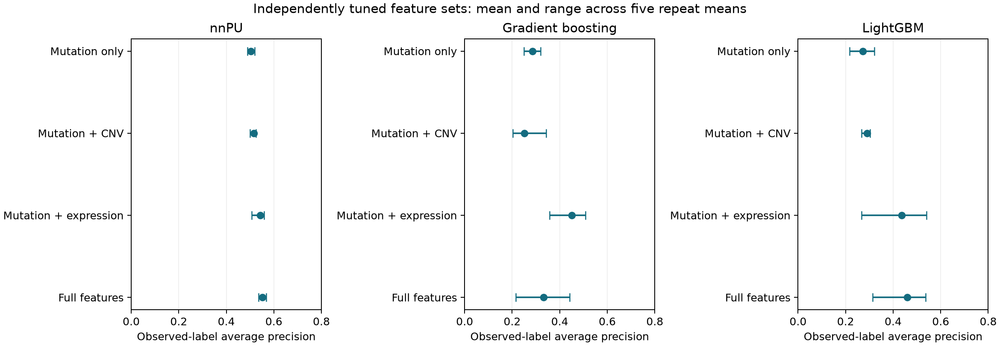
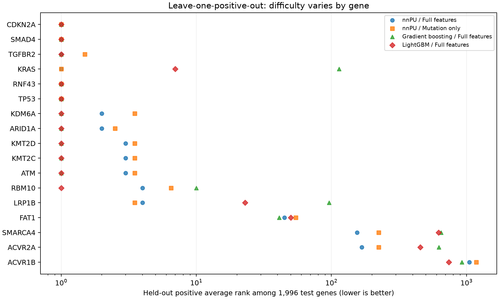
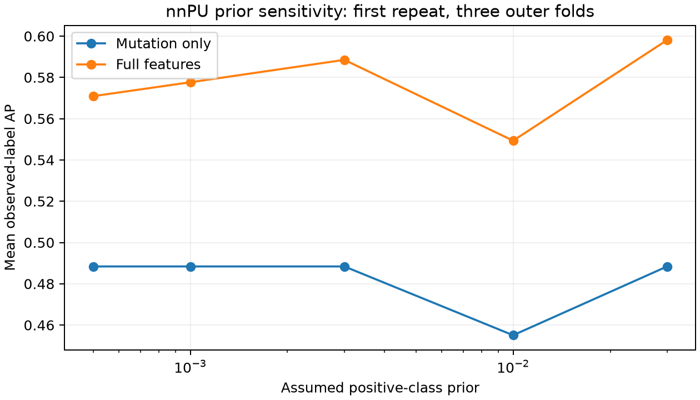

# Final extension experiments — 4 November 2026

This is an addendum to FINAL_RESULTS.md. It answers the remaining feature-value, gene-level,
stability and class-prior questions. All results are exploratory analyses on the existing
dataset. No external labels were added, no new external-test claims are made, and the earlier
analysis snapshots are preserved.

## Main numerical findings

- Highest mean AP in this feature comparison: **nnPU with full features, 0.5517**.
- Independently tuned nnPU mutation-only AP: **0.5025**.
- Independently tuned full-feature nnPU AP: **0.5517**, a difference of **+0.0492**.
- All 17 original positive genes were individually held out and evaluated.
- Candidate stability was measured over 17 positive-deletion fits on the same 1,995 held-out unlabelled genes.
- Five nnPU priors were examined with L2 tuned separately inside training folds.

AP means observed-label average precision, not diagnostic accuracy or precision against proven
negatives. Differences and ranges below are descriptive, not independent confidence intervals.

**Interpretation:** full-feature nnPU improves mean AP over mutation-only learning by 0.0492,
but improves over mutation plus expression by only 0.0089. The latter
difference is positive in 3/5 repeat means and negative in
2/5. The mutation-plus-expression nnPU has higher mean top-100
and top-500 recall (82.0%, 88.0%)
than full nnPU (78.4%, 85.6%). Full nnPU remains
the primary AP comparator, while mutation plus expression is a strong simpler alternative
when candidate recovery is the focus. These findings do not establish a universal winner or
that each extra regulatory assay adds value.

## 1. Separately tuned feature combinations

Each of nnPU, PU gradient boosting and PU LightGBM was evaluated with four feature groups.
Every group was tuned independently, addressing the limitation of the previous fixed-setting
ablations. Mutation uses its prevalence and missingness indicator; the CNV combination adds
amplification and deletion prevalence and their flags; the expression combination adds tumour
expression and its flag; full uses all ten biological features plus ten flags.

Five repeats of three outer folds use the same outer gene partitions as the prior robustness
study. Three inner folds choose settings within each outer training set. Imputation/scaling
are fitted only on that training partition. nnPU searches three priors and two L2 penalties,
with 600 epochs; tree models search depth 2 and 3, with six PU bags and ten sampled unlabelled
genes per positive. Exact stochastic inner-fitting seeds differ from the older run for some
tree fits; compare this addendum's feature sets with each other, not tiny differences between
snapshots. No feature group was chosen using outer-test outcomes during fitting.

| Model | Features | Mean AP | Range of repeat means | Mean top-100 recall |
|---|---|---:|---:|---:|
| Gradient boosting | Full features | 0.3322 | 0.2145–0.4411 | 66.0% |
| Gradient boosting | Mutation only | 0.2856 | 0.2489–0.3199 | 72.6% |
| Gradient boosting | Mutation + CNV | 0.2520 | 0.2028–0.3437 | 68.0% |
| Gradient boosting | Mutation + expression | 0.4501 | 0.3570–0.5081 | 68.2% |
| LightGBM | Full features | 0.4595 | 0.3131–0.5367 | 71.6% |
| LightGBM | Mutation only | 0.2731 | 0.2172–0.3206 | 76.9% |
| LightGBM | Mutation + CNV | 0.2901 | 0.2666–0.3023 | 77.3% |
| LightGBM | Mutation + expression | 0.4364 | 0.2674–0.5406 | 76.9% |
| nnPU | Full features | 0.5517 | 0.5350–0.5684 | 78.4% |
| nnPU | Mutation only | 0.5025 | 0.4884–0.5193 | 77.0% |
| nnPU | Mutation + CNV | 0.5163 | 0.4998–0.5243 | 76.0% |
| nnPU | Mutation + expression | 0.5428 | 0.5067–0.5594 | 82.0% |



Each mean averages three outer folds within a repeat and then five repeats. Top 100 is within
an outer test fold containing about 6,650 genes. The same genes recur across repeats, and
previous exploratory work already informed model-family choice.

### Paired differences relative to mutation-only learning

| Model | Comparison | Mean AP difference | Repeat range | Positive differences |
|---|---|---:|---:|---:|
| nnPU | mutation_cnv minus mutation | +0.0138 | +0.0050 to +0.0278 | 5/5 |
| nnPU | mutation_expression minus mutation | +0.0403 | +0.0131 to +0.0710 | 5/5 |
| nnPU | full minus mutation | +0.0492 | +0.0177 to +0.0748 | 5/5 |
| Gradient boosting | mutation_cnv minus mutation | -0.0336 | -0.1171 to +0.0949 | 1/5 |
| Gradient boosting | mutation_expression minus mutation | +0.1644 | +0.0371 to +0.2592 | 5/5 |
| Gradient boosting | full minus mutation | +0.0466 | -0.1054 to +0.1445 | 4/5 |
| LightGBM | mutation_cnv minus mutation | +0.0169 | -0.0239 to +0.0556 | 3/5 |
| LightGBM | mutation_expression minus mutation | +0.1632 | +0.0502 to +0.2591 | 5/5 |
| LightGBM | full minus mutation | +0.1863 | +0.0934 to +0.3054 | 5/5 |

These comparisons measure the contribution of a feature group under this dataset, grid and
label definition. They do not prove general biological superiority. Mutation-based labels
can favour mutation-derived features. A benefit from CNV or expression does not establish
benefit from every regulatory assay; the full feature group should be compared to the simpler
combinations before claiming that all assays help.

## 2. Leave-one-positive-out evaluation

Each of the 17 known positives is removed completely from training, not recoded as unlabelled.
The other 16 positives and 17,950 unlabelled genes form the training set. The same 1,995
unlabelled genes are held out for every test. Each test therefore contains one known positive
and 1,995 unlabelled comparators. Three-fold inner selection is repeated using training data
only. nnPU full/mutation-only and full-feature gradient boosting/LightGBM are assessed.

| Model/features | Median positive rank | Mean single-positive AP | Top-100 credit | Top-500 credit |
|---|---:|---:|---:|---:|
| Gradient boosting / Full features | 1.0 | 0.5969 | 76.5% | 82.4% |
| LightGBM / Full features | 1.0 | 0.6595 | 82.4% | 88.2% |
| nnPU / Full features | 3.0 | 0.5021 | 82.4% | 94.1% |
| nnPU / Mutation only | 3.5 | 0.4243 | 83.1% | 94.6% |

With one positive and no ties, AP is reciprocal rank. With ties, AP credits the threshold
containing the entire tie group, while the displayed rank is the average tied rank. The saved
table also contains best/worst tied ranks. Top-k credit is fractional at a tie boundary.
Ranks refer to this fixed 1,996-gene test, not the entire genome.

| Held-out gene | nnPU mutation rank | nnPU full rank | Gradient boosting full rank | LightGBM full rank |
|---|---:|---:|---:|---:|
| CDKN2A | 1.0 | 1.0 | 1.0 | 1.0 |
| SMAD4 | 1.0 | 1.0 | 1.0 | 1.0 |
| TGFBR2 | 1.5 | 1.0 | 1.0 | 1.0 |
| KRAS | 1.0 | 1.0 | 114.0 | 7.0 |
| RNF43 | 1.0 | 1.0 | 1.0 | 1.0 |
| TP53 | 1.0 | 1.0 | 1.0 | 1.0 |
| KDM6A | 3.5 | 2.0 | 1.0 | 1.0 |
| ARID1A | 2.5 | 2.0 | 1.0 | 1.0 |
| KMT2D | 3.5 | 3.0 | 1.0 | 1.0 |
| KMT2C | 3.5 | 3.0 | 1.0 | 1.0 |
| ATM | 3.5 | 3.0 | 1.0 | 1.0 |
| RBM10 | 6.5 | 4.0 | 10.0 | 1.0 |
| LRP1B | 3.5 | 4.0 | 96.0 | 23.0 |
| FAT1 | 54.5 | 45.0 | 41.0 | 50.0 |
| SMARCA4 | 223.5 | 155.0 | 649.5 | 622.0 |
| ACVR2A | 223.5 | 168.0 | 625.0 | 455.0 |
| ACVR1B | 1179.5 | 1052.0 | 925.5 | 740.5 |



These results reveal individual genes that are easy or difficult under the chosen features.
They do not independently certify novel-driver discovery. The training sets overlap heavily,
and the background is a fixed sample of unlabelled genes.

## 3. Candidate stability

For each fitted leave-one-positive-out model, we ranked the fixed held-out unlabelled set.
This isolates sensitivity to the available positive examples and the tuning they induce.
It is **not whole-genome candidate stability** and does not independently test random-seed
variability or biological cohort shifts. Training randomness is held fixed between deletions.

At the top-100 boundary, tied candidates share fractional weights summing to exactly 100.
Weighted Jaccard is the sum of pairwise minimum weights divided by the sum of pairwise maximum
weights. It equals 1 for identical selections and 0 for disjoint selections. A high overlap
indicates stability, not correctness.

| Model/features | Mean pairwise weighted Jaccard | Pairwise range | Genes fully selected in all 17 runs |
|---|---:|---:|---:|
| nnpu__full | 0.793 | 0.527–0.942 | 64 |
| nnpu__mutation | 1.000 | 1.000–1.000 | 83 |
| gradient_boosting__full | 0.659 | 0.205–0.961 | 15 |
| lightgbm__full | 0.757 | 0.316–0.980 | 33 |

The complete candidate table records mean top-100 weight, number of full inclusions, mean rank
and rank range. A compact 30-gene shortlist per procedure is saved for review. These are
stable candidates within the held-out background, not validated biomarkers.

## 4. nnPU class-prior sensitivity

The prior is an assumption about hidden positive prevalence in PU risk estimation, not an
estimate established by these data. Five values (0.0005, 0.001, 0.003, 0.01, 0.03) span 0.05%
to 3%. For each fixed prior, L2 is tuned separately inside each outer training partition.
This diagnostic uses only the first repeat's three outer folds and does not select a new
production prior from test performance.

| Features | Fixed prior | Mean AP | Mean top-100 recall | Mean top-500 recall |
|---|---:|---:|---:|---:|
| Full features | 0.0005 | 0.5709 | 82.2% | 87.8% |
| Full features | 0.001 | 0.5776 | 82.2% | 87.8% |
| Full features | 0.003 | 0.5885 | 76.7% | 87.8% |
| Full features | 0.01 | 0.5493 | 76.7% | 82.2% |
| Full features | 0.03 | 0.5981 | 76.7% | 82.2% |
| Mutation only | 0.0005 | 0.4884 | 77.6% | 85.3% |
| Mutation only | 0.001 | 0.4884 | 77.6% | 85.3% |
| Mutation only | 0.003 | 0.4884 | 77.6% | 85.3% |
| Mutation only | 0.01 | 0.4551 | 77.6% | 85.3% |
| Mutation only | 0.03 | 0.4884 | 77.6% | 85.3% |



Do not interpret model scores as calibrated probabilities. Stability across priors would
support rank robustness over the tested range, not prove the true biological class proportion.

## Verification and preserved scope

- 64 automated tests passed, including feature-group isolation, held-out-data isolation and tie-budget checks.
- 180 independently tuned outer model/feature evaluations and 68 leave-one-positive-out evaluations completed.
- All 248 saved model bundles reproduced predictions exactly on their evaluation inputs.
- All source/output hashes checked; each gene occurs once per outer test repeat.
- Thirty fixed-prior outer evaluations completed, corresponding to two feature sets x five priors x three folds.
- The original 17-positive labels, original models and all earlier results were preserved.
- The external MSK/autopsy and CRISPR limitations from FINAL_RESULTS.md remain unchanged.

The protocol was saved before fitting at `configs/final_extension_v1.json`. Outputs are under
`data/processed/final_extension_v1/`. Key files: `feature_summary.csv`,
`paired_feature_differences.csv`, `lopo_results.csv`, `stability_summary.csv`,
`candidate_stability.csv`, `stable_candidate_shortlists.csv`, and `prior_summary.csv`.

Reproduce from the project root:

```powershell
.\.venv\Scripts\python.exe scripts/final_extension.py .
.\.venv\Scripts\python.exe scripts/report_final_extension.py .
.\.venv\Scripts\python.exe -m pytest -q
```

The experiment script reuses saved checkpoints only under the same source-code hash. It does
not silently replace prior analyses. The report builder verifies the completed manifest first.
Use this addendum when writing the feature-value and robustness sections of the report.
