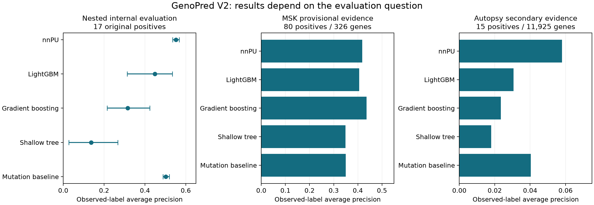
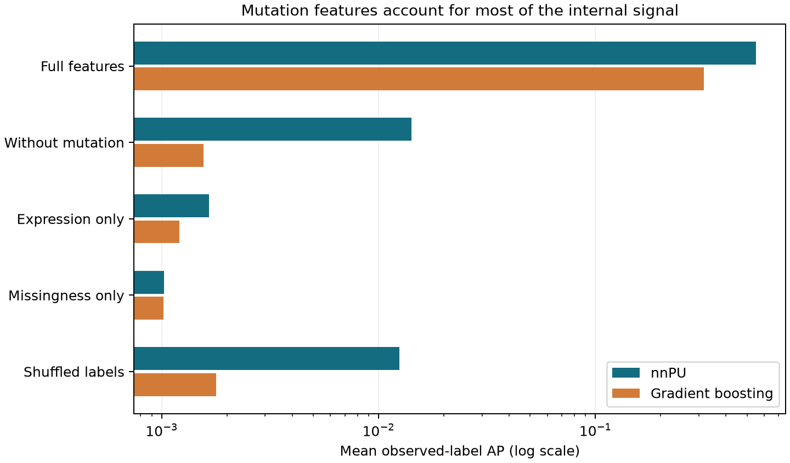

# GenoPred V2 — final exploratory results for report writing

**Analysis snapshot: 4 November 2026.** Stages 1–6 are complete. This package adds repeated
internal evaluation and external evidence assessments. It does not establish clinical utility,
fully independent gold-standard validation, or completion of Stage 7 transfer learning.

## Main conclusion

**nnPU is the strongest primary comparator in the completed repeated internal evaluation.**
Its mean observed-label average precision is **0.5517**, compared with **0.5025 for mutation
prevalence alone**, 0.4490 for LightGBM, 0.3160 for gradient boosting and 0.1365 for the shallow
tree. This reverses the apparent advantage of the shallow tree on the earlier three-positive
test split. The earlier result remains an exploratory historical result, not the headline.

Most internal predictive signal depends on mutation features. External evidence is mixed:
gradient boosting has the largest AP point estimate on provisional MSK labels, nnPU has the
largest AP on the small source-reconciled autopsy assessment, and CRISPR survival associations
are weak. The project supports **candidate prioritization and methodological comparison**,
not diagnosis, clinical decision-making or validated discovery of novel drivers.

## Report scope, objectives and question

Suggested title: **GenoPred V2: Reproducible Multi-Omic Feature Integration and
Positive–Unlabelled Learning for Pancreatic Cancer Driver-Gene Prioritization.**

Research question: How reliably can pancreatic molecular features rank known and independently
reported candidate driver genes, and how do linear nnPU, tree methods and simple biological
baselines compare under leakage-controlled evaluation?

Objectives:

1. Build a reproducible gene-level pancreatic dataset with aligned identifiers and assay QC.
2. Construct conservative positive/unlabelled labels without treating absent evidence as negative.
3. Compare ranking procedures and quantify sensitivity to data splits and feature groups.
4. Assess consistency with external clinical-genomic and functional evidence, retaining its limits.

The project contains 19,962 protein-coding genes, 10 biological measurements and 10 missingness
indicators. Labels remain the original 17 IntOGen-supported positives and 19,945 unlabelled genes.
No external genes were added to training. The implemented reference nnPU is **linear** non-negative
PU risk minimization, not a deep neural network. Breast-to-pancreas transfer is not implemented
in this completed core study and must not appear as a completed methodology in the report.

## 1. Repeated nested evaluation: primary internal results

Five fixed random seeds each define three stratified outer folds. Each gene appears in the
outer test set once per repeat. An outer fold contains five or six known positives and about
6,650 unlabelled genes. For each model, three inner folds select hyperparameters by mean
observed-label AP. Imputation and scaling are fitted only on the relevant training partition.
Outer test features and labels do not participate in fitting or selection.

nnPU searches the original three class priors (0.001, 0.003, 0.01) and two L2 penalties
(0.0001, 0.01), with 600 epochs. Each tree family searches depth 2 or 3 using six PU bags per
fit and ten sampled unlabelled genes per training positive. This repeated procedure uses one
fixed seed per fit, unlike the earlier three-seed ensemble benchmark. It compares procedures,
not repeated evaluation of the exact historical fitted model files. The external assessments
continue to use those original frozen predictions.

The table averages metrics within each repeat's three outer folds and then across five repeats.
The range is across repeat means, **not a confidence interval**. These repeats share genes,
labels and feature sources and are not independent biological replications. The design was
created after earlier screening, so this is retrospective robustness evidence.

| Model | Mean observed-label AP | Range of repeat means | Mean top-100 recall | Mean top-500 recall |
|---|---:|---:|---:|---:|
| nnPU | 0.5517 | 0.5350–0.5684 | 78.4% | 85.6% |
| LightGBM | 0.4490 | 0.3131–0.5339 | 71.6% | 80.9% |
| Gradient boosting | 0.3160 | 0.2145–0.4233 | 64.9% | 75.1% |
| Shallow tree | 0.1365 | 0.0278–0.2673 | 54.5% | 64.0% |
| Mutation baseline | 0.5025 | 0.4884–0.5193 | 77.0% | 85.2% |

Top-k recall is measured within each outer test fold, not among all 19,962 genes. Tied score
cutoffs receive fractional credit rather than arbitrary gene-ID ordering. AP uses known positives
versus unlabelled comparators; it is neither accuracy nor true precision against established
negatives. Do not write “55.2% accuracy.”

nnPU exceeds the mutation baseline AP in all five repeat means; the mean difference is
0.0492, ranging from 0.0177 to 0.0748. This is a descriptive
comparison. No independently powered superiority claim or formal confidence interval is made.



The three panels use different gene universes, label prevalences and x-axis limits.
Compare models within a panel, not absolute AP values across panels.

## 2. Feature dependence and negative controls

Ablations reuse settings selected on the full-feature inner folds and refit on outer training
genes only. They diagnose dependence under fixed settings; they are not separately optimized
models and cannot establish that an assay is universally uninformative.

| Diagnostic | nnPU mean AP | Gradient boosting mean AP |
|---|---:|---:|
| Full features | 0.5517 | 0.3160 |
| Without mutation | 0.0142 | 0.0016 |
| Expression only | 0.0016 | 0.0012 |
| Missingness only | 0.0010 | 0.0010 |
| Shuffled labels | 0.0125 | 0.0018 |



Removing mutation prevalence and its missingness flag greatly reduces AP. Expression-only
and missingness-only models are near the observed-positive prevalence (about 0.00085 overall).
Shuffled-label results are low and variable, as expected with few positives. The defensible
interpretation is that mutation features dominate this dataset. **The study has not demonstrated
a robust benefit of combining all assays over mutation evidence alone.** The small nnPU advantage
over the mutation baseline warrants further study rather than a strong multi-omic superiority claim.

## 3. External assessments: keep the endpoints separate

| Model | MSK AP | MSK top-100 recall | Autopsy AP | Autopsy top-500 recall | CRISPR correlation |
|---|---:|---:|---:|---:|---:|
| nnPU | 0.4179 | 47.5% | 0.0581 | 53.3% | 0.0229 |
| LightGBM | 0.4056 | 41.2% | 0.0306 | 53.3% | 0.0695 |
| Gradient boosting | 0.4365 | 42.5% | 0.0234 | 40.0% | 0.0504 |
| Shallow tree | 0.3490 | 36.8% | 0.0180 | 54.0% | 0.0670 |
| Mutation baseline | 0.3500 | 46.0% | 0.0403 | 47.9% | -0.0415 |

### MSK: 80 provisional evidence genes among 326 eligible panel genes

The published 2,336-patient supplementary dataset contains 9,024 alteration rows. The audit
retains sequence-alteration evidence in at least three distinct patients, restricts the universe
to consistently assayed IMPACT341 genes, requires unique gene mapping and excludes all 17
original positives. This leaves 80 provisional evidence positives and 246 unlabelled comparators.

The completed 80-gene review includes supporting alterations, patient counts, source annotation,
pancreatic context, overlap concerns and an inclusion decision. Of 924 sequence-alteration rows
for these genes, 917 match public cBioPortal sample/gene/protein records. Seven remain unmatched
under exact protein-string matching, including splice/frameshift representations and one missing
protein description. They are flagged, not silently corrected. The API contains no explicit
per-variant driver annotation fields for this cohort. **Zero genes were promoted to independently
confirmed driver labels** by this audit.

The paper describes OncoKB oncogenic/likely-oncogenic annotation, but the workbook lacks a
per-row confidence field. The study's pancreatic context is verified at cohort level, not
gene-specific causation. Patient identity across TCGA/CPTAC/ICGC and this cohort is unresolved.
The 80-gene review is a reproducible provenance audit, not an expert literature adjudication of
all 80 genes. Keep its benchmark provisional. Known database annotations can share underlying
knowledge with the training evidence even when clinical cohorts differ.

Gradient boosting has the highest MSK AP point estimate; nnPU retrieves 38/80 evidence genes
in its top 100. No paired superiority test establishes a winner. The original genes were present
as unlabelled training examples, so this is transductive external label confirmation rather than
generalization to genes never encountered during training.

### Additional autopsy cohort: 15 new sequence-evidence genes

An official Europe PMC supplementary archive was acquired for the 2026 Cancer Discovery paper
on TGF-beta signalling in advanced pancreatic cancer. Its cohort contains 30 Johns Hopkins
research-autopsy donors and 210 tumour samples represented in Table S3.

An important source discrepancy was detected. Applying LiFD > 0 to the full supplement produces
1,098 genes, not the publication's displayed 32-gene set. That initial broad extraction and its
metrics are retained only for audit and **excluded from headline driver validation**.

Restricting to the explicit Figure 1C gene list reproduces the reported **792 positive sequence
records**. These span 28 genes; CDH1, GATA6, MUC16 and MYC have no LiFD-positive sequence rows
in that set. After removing the 13 overlapping original positives, **15 new evidence genes**
remain among 11,925 uniquely mapped, mutation-ascertained background genes. Nine overlap the
MSK 80; six do not: BMPR1B, DNMT3A, DNMT3B, KMT2E, PCDH15 and SMARCB1. Do not add these
cohorts' positive counts as if they were disjoint.

The new set is: ARID1B, ARID2, BMPR1B, DNMT3A, DNMT3B, FBXW7, GNAS, KLF4, KMT2A, KMT2E, PCDH15, SF3B1, SMARCB1, STK11, TGFBR1.

The supplement contains 64,543 data rows versus 64,544 reported in the text. The selected rows
contain 98 unique gene/protein strings versus 99 variants reported in the paper; distinct genomic
variants can share protein representation, so these are not necessarily equivalent counts.
These discrepancies remain documented. Source reconciliation occurred after the broad extraction
had been scored, with a saved amendment based on the published gene set, not on model performance.
Therefore this is a **secondary, source-reconciled assessment**, not a pristine preregistered test.

nnPU AP is 0.0581 and it retrieves 8/15 positives in the top 500. The background positive fraction
is about 0.00126, but background genes are not confirmed negatives. LiFD itself integrates public
databases and computational predictors, so this is additional computational evidence, not an
orthogonal experimental driver validation. Cross-study donor overlap is still not certified.

### CRISPR survival: weak orthogonal support

The prior Sanger Project Score assessment evaluated 15,767 eligible unlabelled non-common-essential
genes across 33 pancreatic adenocarcinoma donors, with 856 other-cancer donors for specificity.
Known PANC-1 donor-related models were excluded. Primary correlations range from 0.0229 to
0.0695 for the four models. None of their top-100 lists is enriched against random gene sets.
Pancreatic specificity is weak. The tree's nominal top-500 expands to 1,684 genes through ties.

Cell-survival dependency is not the same as cancer-driver activity. Tumour suppressors need not
behave as knockout dependencies. These findings neither validate all driver predictions nor
prove every candidate wrong. They limit claims of functional support.

## 4. Why the models disagree

Among originally unlabelled genes, nnPU score correlates 0.662 with mutation prevalence and
0.366 with expression. Gradient boosting correlations are 0.352 and 0.526; LightGBM correlations
are 0.256 and 0.624. These are associations, not causal feature importance.

nnPU and gradient boosting share 53 genes in their respective top 100; nnPU and LightGBM share
82. The shallow tree's tied top-100 threshold includes 103 genes in this whole-unlabelled-universe
comparison. A saved candidate-review table combines ranks, mutation/CNV/expression features,
missingness, MSK evidence and CRISPR outcomes. Use it to illustrate agreement and disagreement,
not to label individual genes as newly discovered drivers.

## 5. Scope limits and unfinished external work

- Original labels are computationally supported and incomplete; there are no reliable negatives.
- Only 17 original positives constrain evaluation precision and biological coverage.
- Prior model screening consumed the old test split; the new nested analysis remains retrospective.
- Dataset-level biological feature processing predates gene folds. The new separation concerns
  gene-level fitting/preprocessing, not independent patient-cohort generalization.
- External genomic label sets have unresolved annotation/overlap issues and have now been seen.
- The mouse Sleeping Beauty screen was not evaluated. Modern and original PNAS supplement URLs
  returned HTTP 403; PMC returned verification HTML and Europe PMC did not supply those files.
  No verified mouse gene table or human-orthologue mapping was available. No result is invented.
- Licensed variant reannotation, donor-level provenance reconciliation and expert gene-specific
  causal review remain future work. Neither a fully independent gold-standard test nor clinical
  validation has been completed.
- Stage 7 transfer learning is outside this frozen core-study report and remains unimplemented.

## 6. Verification and reproducibility

All **58 automated tests pass**, including new checks that perturbing held-out features and labels
cannot change nnPU or gradient-boosting fitting, and that tied scores receive fair top-k credit.
All **60 nested-CV model bundles** reproduce their saved predictions exactly. Every gene is
held out exactly once per repeat; all outer partitions are disjoint and cover the full gene set.
All 5 x 19,962 x 13 stored out-of-fold scores are finite. The original labels remain unchanged.

The earlier 60-row benchmark is preserved. Do not rerun or overwrite old experiments to make
their results agree with the new evaluation. Protocols, fold assignments, inner selections,
models, raw source hashes and output manifests are saved for audit.

| Artifact | Purpose |
|---|---|
| `data/processed/final_results_v1/final_comparison.csv` | Main numerical table |
| `data/processed/final_robustness_v1/` | Nested folds, model bundles, selections, OOF scores, ablations |
| `data/processed/final_evidence_audit_v1/msk_80_gene_quality_review.csv` | Per-gene evidence audit |
| `data/processed/final_evidence_audit_v1/msk_80_gene_variants.csv.gz` | Supporting variants and match flags |
| `data/processed/final_evidence_audit_v1/top_candidate_review.csv` | Model disagreement and biological evidence |
| `data/processed/autopsy_evidence_reconciled_v1/` | Secondary reconciled autopsy evidence and results |
| `configs/final_robustness_v1.json` | Nested-evaluation protocol saved before training |
| `configs/autopsy_reconciliation_v1.json` | Transparent source interpretation amendment |

Reproduction commands from the project folder:

```powershell
.\.venv\Scripts\python.exe scripts/final_robustness.py .
.\.venv\Scripts\python.exe scripts/build_final_results.py .
.\.venv\Scripts\python.exe -m pytest -q
```

Raw Excel-reading audits require openpyxl in addition to the project scientific dependencies.
This run used the bundled openpyxl reader with the project numpy/pandas/scipy environment,
without modifying installed dependencies. Pure model evaluation and report generation use the
project venv. All sources are retained locally for research; source licensing still applies.

## 7. What to say in the report

Recommended result statement:

> GenoPred V2 provides a reproducible pancreatic driver-gene prioritization pipeline. In repeated
> nested gene-level evaluation using 17 conservative positive labels, linear nnPU achieved the
> highest mean observed-label average precision among the shortlisted procedures. Mutation
> prevalence explained most of the observed signal. External computational evidence showed
> enrichment with dataset-dependent model rankings, while functional dependency support was
> weak. These results support exploratory candidate prioritization and motivate stronger
> independent validation, rather than establishing clinical utility or novel driver discovery.

Use nnPU as the primary method for presenting this completed study, mutation prevalence as the
essential baseline, and LightGBM/gradient boosting as substantive alternative models. Report
the shallow tree and its split sensitivity openly. This is a presentation choice based on the
completed analyses, not a new claim of an independently validated best model.

## Primary sources

- [MSK study and supplementary-data description](https://pmc.ncbi.nlm.nih.gov/articles/PMC11835752/).
- [MSK public study](https://www.cbioportal.org/study/summary?id=pdac_msk_2024).
- [Sanger CRISPR dataset methods](https://depmap.sanger.ac.uk/documentation/datasets/wg-crispr-knockout/).
- [Autopsy study](https://pmc.ncbi.nlm.nih.gov/articles/PMC13223546/).
- [Mouse screen, currently unassessed](https://pmc.ncbi.nlm.nih.gov/articles/PMC3341075/).
